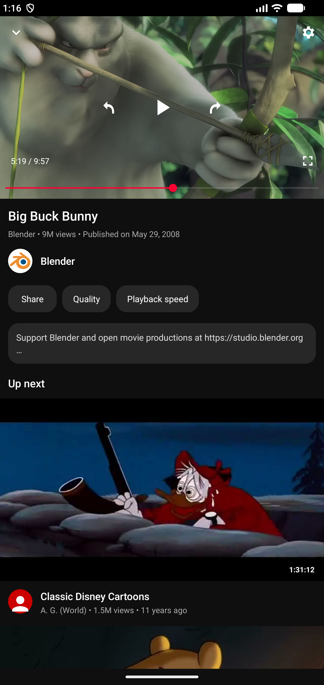
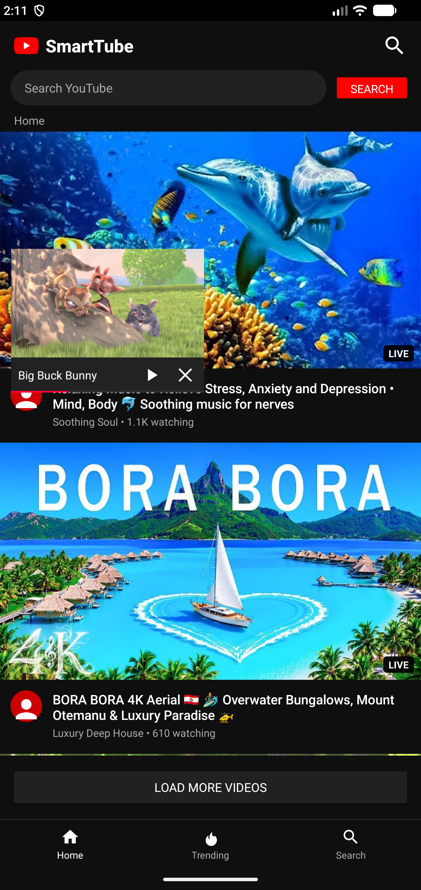
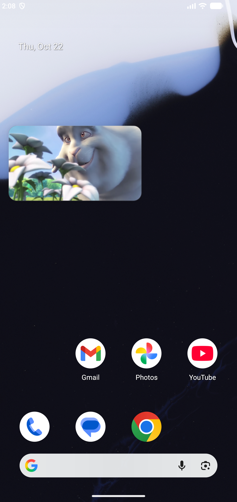

# SmartTube for Android Phones

A touch-friendly Android phone adaptation of [SmartTube](https://github.com/yuliskov/SmartTube), with a portrait watch page, a draggable miniplayer, and playback in Android Picture-in-Picture.

This is an independent community port maintained in [chsaqib/smarttube](https://github.com/chsaqib/smarttube). It is not an official SmartTube or YouTube release.

**[Download smarttube.apk](https://github.com/chsaqib/smarttube/releases/latest/download/smarttube.apk)** · [Releases](https://github.com/chsaqib/smarttube/releases) · [Report an issue](https://github.com/chsaqib/smarttube/issues)

## Phone features

- Touch-friendly Home and Trending feeds, thumbnails, video details, search, and pagination.
- Portrait watch page with a 16:9 video, title, channel, expandable description, and related videos.
- Landscape fullscreen playback with the system bars hidden.
- Play/pause, timeline seeking, 10-second jumps, and double-tap seeking.
- Quality, playback speed, and caption selection using the existing playback engine.
- Draggable in-app miniplayer: browse or search while the video keeps playing.
- Android Picture-in-Picture: continue watching over the Home screen or other apps, move the window, or expand it back into the app.
- Close controls stop playback and remove the player.
- Separate package ID, `app.smarttube.phone`, so the phone and upstream TV apps can coexist.

<p>
  
  
  
</p>

## Install

1. Open [Releases](https://github.com/chsaqib/smarttube/releases) on your phone and download **smarttube.apk**.
2. Allow your browser or file manager to install this APK when Android asks.
3. Install and open SmartTube.

The first release is an **ARM64 debug preview** for modern ARM64 Android phones. It is the same build tested during development, not a production-signed release. Install it over previous phone builds signed with the same key; other signing keys require uninstalling the old build first, which removes its local data.

Android PiP requires a supported Android 8.0+ device and the app's Picture-in-Picture permission. If necessary, enable it in Android Settings → Apps → SmartTube → Picture-in-picture. No “display over other apps” permission is required.

## Playback and navigation

| Action | Result |
| --- | --- |
| Back in fullscreen | Return to the portrait watch page |
| Back on the portrait watch page | Minimize into a floating player over the feed |
| Drag the small video or its title area | Move the in-app player |
| Tap the in-app player | Return to the watch page |
| Home while playing | Continue in Android PiP |
| Back from the feed while playing | Clear an active search first, then leave the app in PiP |
| Tap the Android PiP window | Show Android's playback, expand, and close controls |
| Press × | Stop and close the player |

## Current status

This is an early phone port, not complete YouTube feature parity. The phone UI does not yet provide dedicated account/sign-in, subscriptions, history, channel, playlist, or comment screens. TV-specific features and settings have not all been adapted or verified for touch use.

The current build was checked with real playback in the Note 10 Plus Android Studio emulator, including rotation, seeking, quality selection, scrolling during playback, in-app dragging, PiP entry, PiP dragging, restoration, and closing. Physical-device testing is still needed; please include your Android version, device model, and steps when reporting an issue.

Inherited native dependencies can trigger a **16 KB page-size compatibility warning** on newer Android devices. Updating those libraries remains outstanding. Video availability and stream playback also depend on the upstream services.

## Build from source

Clone with submodules:

```sh
git clone --recurse-submodules https://github.com/chsaqib/smarttube.git
cd smarttube
```

Use **JDK 17**, Android SDK platform **34**, and the included Gradle wrapper. Set your Android SDK path in Android Studio or an untracked `local.properties` file.

```sh
# Linux / macOS
chmod +x gradlew
./gradlew :smarttubetv:assembleStphoneDebug --console=plain

# Windows PowerShell
.\gradlew.bat :smarttubetv:assembleStphoneDebug --console=plain
```

APKs are generated in `smarttubetv/build/outputs/apk/stphone/debug/`. The published `smarttube.apk` is the ARM64 variant renamed for download. APKs built locally or in CI may use a different debug signing key.

Phone-specific code and resources live in `smarttubetv/src/stphone`. The upstream TV variants are retained. The **Build Phone APK** GitHub Actions workflow also builds the phone variant and uploads an artifact containing `smarttube.apk`.

For emulator checks, start a video on the portrait watch page and run one of the PowerShell scripts with ADB available:

```powershell
.\scripts\check-phone-miniplayer.ps1
.\scripts\check-phone-floating.ps1
```

The floating-player check leaves playback in PiP for inspection of Android's native drag, expand, and close controls.

## Credits and license

This project builds on **yuliskov and the SmartTube contributors'** playback engine and services. Upstream development, TV documentation, and releases remain at [yuliskov/SmartTube](https://github.com/yuliskov/SmartTube). The original project README is preserved in [README-UPSTREAM.md](README-UPSTREAM.md).

The original [MIT license](LICENSE) and copyright notice are preserved. Dependencies and submodules retain their respective licenses. SmartTube and YouTube are separate projects; this phone port is not affiliated with Google or YouTube.
